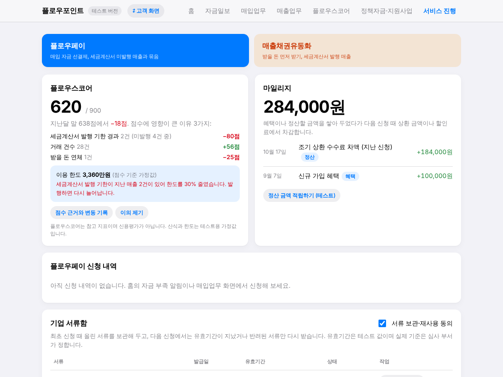
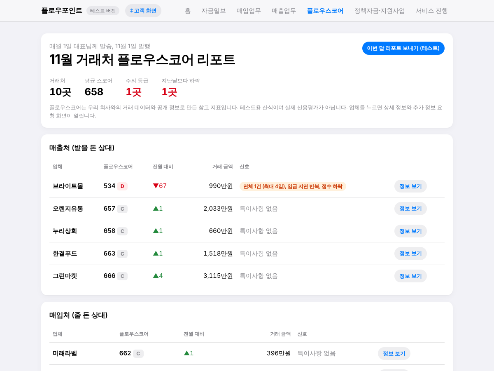
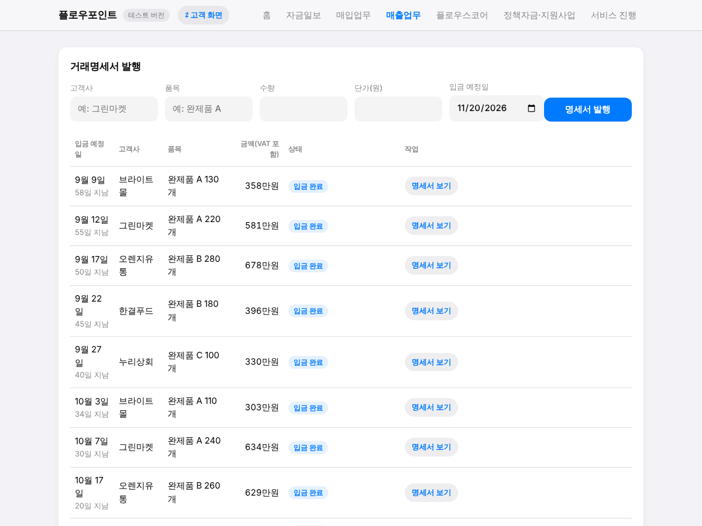
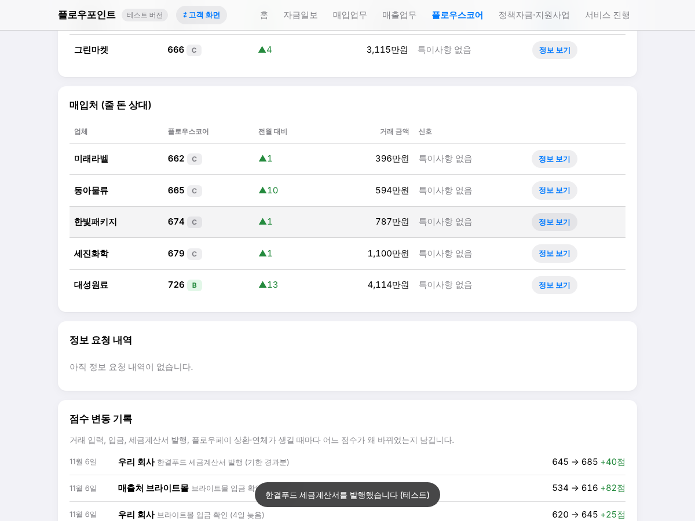
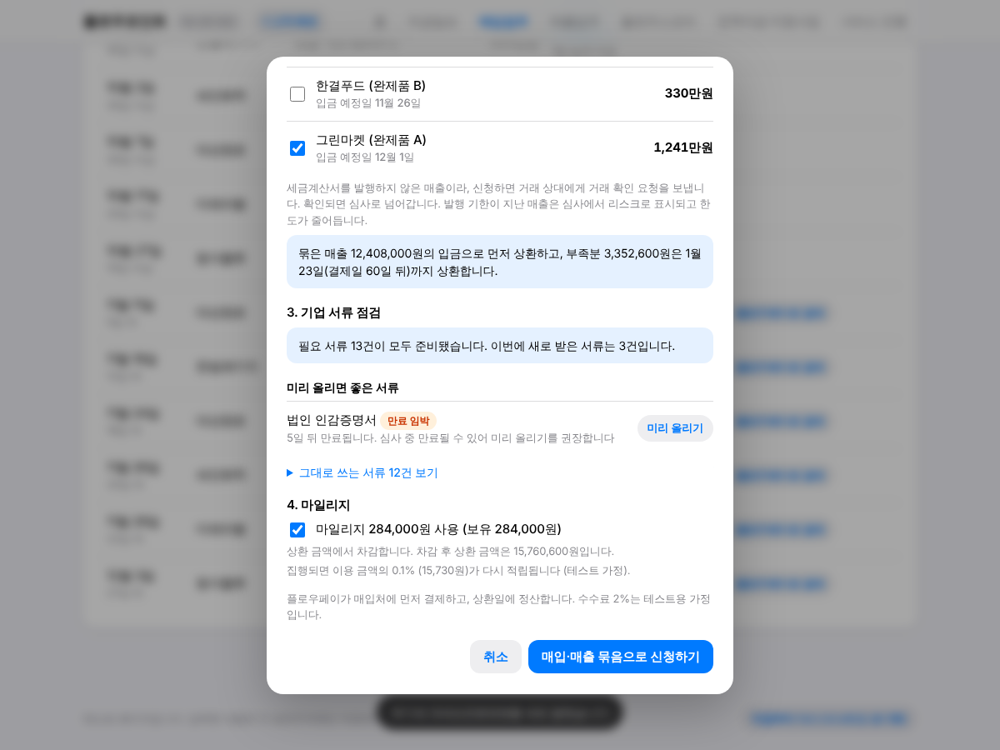
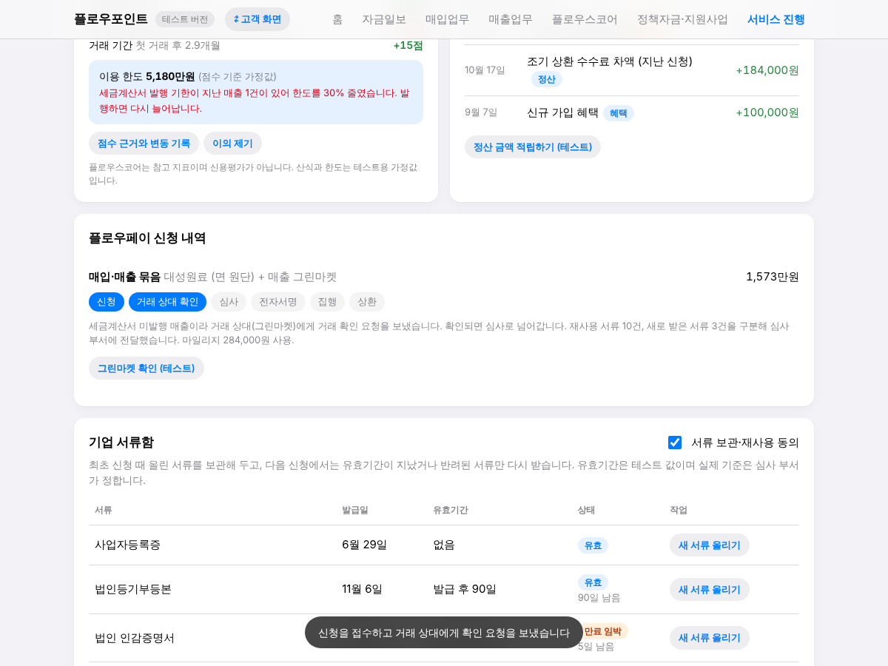
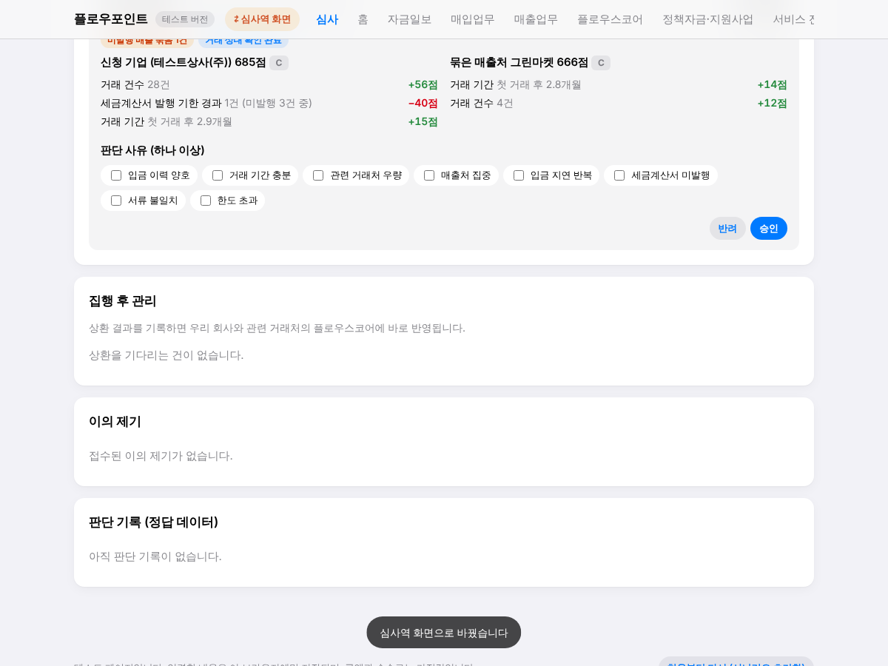
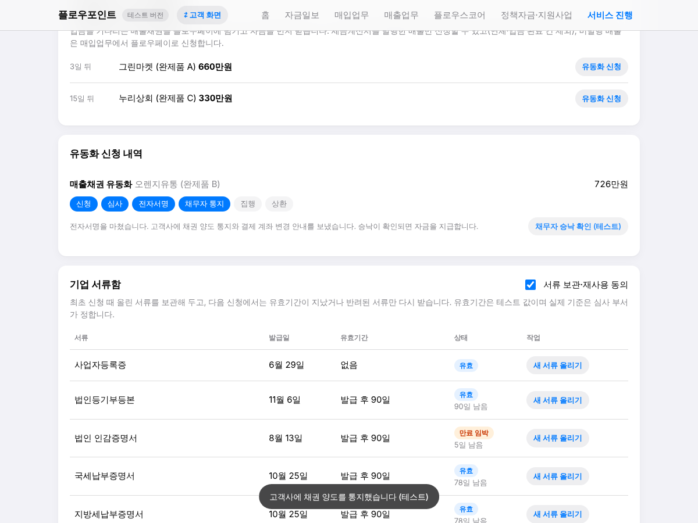
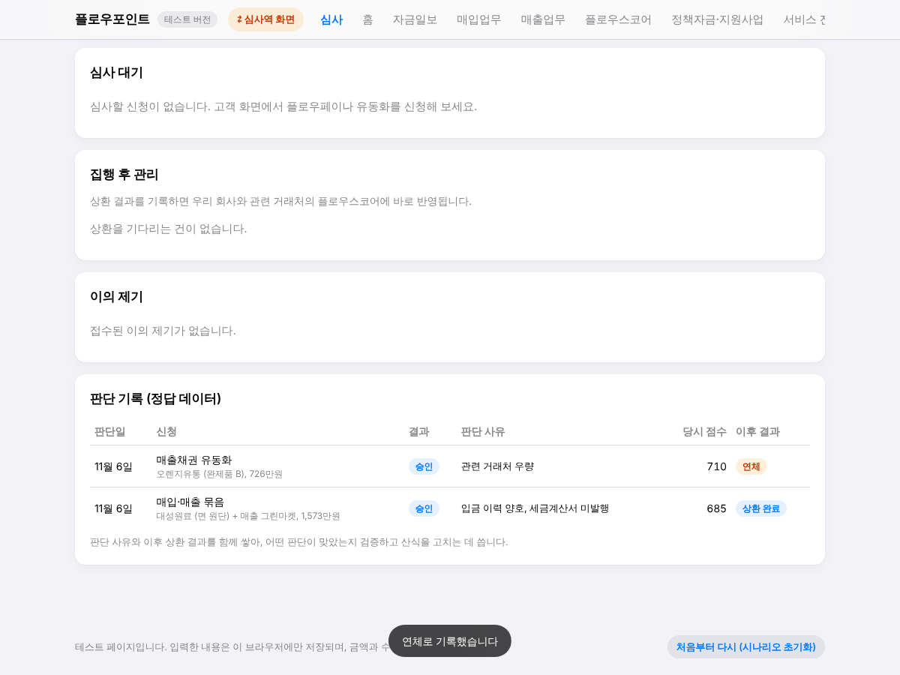
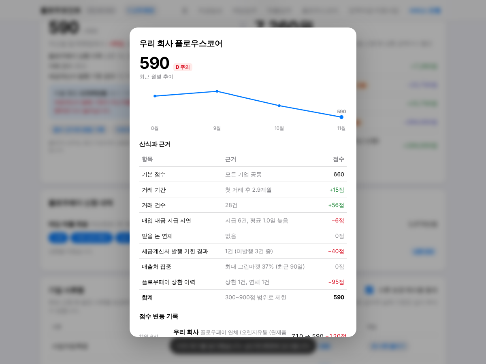

# 플로우포인트 선순환 검증 시나리오

영업팀과 심사팀이 **같은 순서로** 눌러 보며 확인하는 안내서입니다.
목표는 "업무 솔루션 → 플로우스코어 → 플로우페이 → 상환 결과 → 점수 갱신"이 한 바퀴 도는지 보고, 화면 구조와 데이터 항목에 합의하는 것입니다.

> 모든 회사, 금액, 수수료, 점수 산식, 한도는 **테스트용 가정값**입니다. 실제 신용평가나 심사 기준이 아닙니다.

## 시작 전에

1. `index.html`을 브라우저(Chrome, Safari, Edge)로 엽니다.
2. 화면 맨 아래 **처음부터 다시 (시나리오 초기화)** 를 눌러 모두 같은 상태에서 시작합니다.
3. 상단의 **⇄ 고객 화면** 버튼을 누르면 심사역 화면으로 바뀌고, 다시 누르면 고객 화면으로 돌아옵니다.

### 시나리오 회사

| 구분 | 업체 | 특징 |
|---|---|---|
| 우리 회사 | 테스트상사(주) | 제조·도소매, 거래 3개월 |
| 매출처 | 그린마켓, 오렌지유통, 누리상회 | 정상 거래 |
| 매출처 | **브라이트몰** | 리스크 사례 1: 입금이 매번 12~13일 늦고, 지금 4일 연체 중 |
| 매출처 | **한결푸드** | 리스크 사례 2: 세금계산서를 발행하지 않은 매출이 많고, 발행 기한이 지난 건이 있음 |
| 매입처 | 대성원료, 한빛패키지, 세진화학, 동아물류, 미래라벨 | 정상 거래 (미래라벨은 우리가 5일 늦게 지급한 이력) |

---

## 영업팀 순서 (고객 화면)

### 1. 시작 상태 보기
**서비스 진행** 메뉴를 엽니다.

- 우리 회사 플로우스코어 **620점**, 점수에 영향이 큰 이유 3가지가 보입니다.
- 이용 한도는 **3,360만 원**이고, 세금계산서 발행 기한이 지난 매출 때문에 30% 줄었다는 안내가 붙어 있습니다.

**플로우스코어** 메뉴에서 거래처 10곳의 점수와 신호를 봅니다. 브라이트몰에 "연체, 입금 지연 반복" 신호가 붙어 있습니다.

### 2. 연체된 돈 받기
**매출업무**에서 브라이트몰 줄의 **입금 확인**을 누릅니다.

- 브라이트몰 점수가 534점에서 616점으로 오르고, 우리 회사 점수도 오릅니다. 연체가 풀렸기 때문입니다.
- 다만 "입금 지연" 항목은 여전히 감점으로 남습니다. 늦게 들어온 기록은 사라지지 않습니다.

### 3. 밀린 세금계산서 발행하기
매출업무에서 **발행 기한 경과** 표시가 붙은 한결푸드 줄의 **세금계산서 발행**을 누릅니다.

- 우리 회사 점수가 40점 오르고, 한도도 늘어납니다.
- **플로우스코어** 메뉴 맨 아래 **점수 변동 기록**에서 어떤 사건으로 몇 점이 바뀌었는지 확인합니다.

### 4. 플로우페이 신청 (매입 + 미발행 매출 묶음)
**매입업무**에서 대성원료 650개 줄의 **플로우페이로 결제**를 누릅니다.

1. 함께 묶을 매출로 **그린마켓 (470개)** 을 고릅니다.
2. 반려된 서류(대표자 신분증 사본)가 있으면 **새 서류 올리기**를 누릅니다.
3. **매입·매출 묶음으로 신청하기**를 누릅니다.

세금계산서를 발행하지 않은 매출이라 바로 심사로 가지 않습니다. 먼저 **거래 상대 확인** 단계에서 멈춥니다. 서비스 진행 화면에서 **그린마켓 확인 (테스트)** 를 누르면 심사로 넘어갑니다.

---

## 심사팀 순서 (심사역 화면)

### 5. 심사하기
상단 **⇄ 고객 화면** 버튼을 눌러 심사역 화면으로 바꿉니다. **심사** 메뉴가 열립니다.

- 신청 기업과 묶인 매출처의 점수, 이유 3가지, 리스크 표시를 확인합니다.
- **판단 사유**를 하나 이상 고른 뒤 **승인** 또는 **반려**를 누릅니다. 사유 없이는 승인되지 않습니다.

### 6. 전자서명과 집행 (고객 화면)
고객 화면으로 돌아가 서비스 진행에서 **전자서명하기**를 누르면 집행됩니다.

### 7. 상환 결과 기록
다시 심사역 화면으로 바꿔 **집행 후 관리**에서 **상환 완료**를 누릅니다. 우리 회사 점수가 25점 오릅니다.

### 8. 유동화와 채무자 통지 (리스크 통제 확인)
1. 고객 화면 **매출업무**에서 오렌지유통 줄의 **유동화 신청**을 누르고, 확인 항목 두 개를 체크한 뒤 신청합니다.
2. 심사역 화면에서 사유를 골라 승인합니다.
3. 고객 화면 **서비스 진행 → 매출채권유동화**에서 **전자서명하기**를 누릅니다. 아직 돈이 나가지 않고 **채무자 통지** 단계에서 멈춥니다.
4. **채무자 승낙 확인 (테스트)** 를 눌러야 자금이 지급됩니다.

5. 심사역 화면 **집행 후 관리**에서 이번에는 **연체 처리**를 누릅니다. 우리 회사는 120점, 오렌지유통도 120점 내려갑니다.
6. **판단 기록 (정답 데이터)** 표에 판단 사유와 이후 결과(상환 완료, 연체)가 나란히 쌓인 것을 확인합니다.

### 9. 이의 제기
고객 화면 서비스 진행에서 **이의 제기**를 눌러 내용을 남깁니다. 심사역 화면 **이의 제기**에 표시되고, 심사 대기 건에는 "이의 제기 접수 중" 표시가 붙습니다.

**점수 근거와 변동 기록**을 누르면 산식 전체(기본 점수와 항목별 가감점)를 볼 수 있습니다.

---

## 회의용 확인 질문

### 영업팀
1. 고객이 이 화면을 **매일 열 이유**가 있나요? 자금일보, 연체 알림, 세금계산서 기한 알림 중 무엇이 가장 강한가요?
2. 발주·거래명세서 입력이 고객에게 **부담**인가요? 이카운트·더존 같은 기존 ERP 연동이 먼저 필요한가요?
3. 거래 상대 확인 요청(미발행 매출)을 고객의 거래처가 **실제로 눌러 줄까요?**
4. 점수와 한도를 고객에게 **그대로 보여줘도** 되나요?

### 심사팀
1. 산식 항목(거래 기간, 건수, 입금 지연, 연체, 세금계산서 발행 기한, 매출처 집중, 상환 이력)에 **빠진 것이나 빼야 할 것**이 있나요?
2. 가감점 크기에 동의하나요? 예를 들어 연체 1건 −60점, 플로우페이 연체 1건 −120점이 적절한가요?
3. 판단 사유 8개 항목(입금 이력 양호, 거래 기간 충분, 관련 거래처 우량, 매출처 집중, 입금 지연 반복, 세금계산서 미발행, 서류 불일치, 한도 초과)으로 **실제 판단을 다 표현할 수 있나요?**
4. 세금계산서 발행 기한 경과 시 **한도 30% 감액**이 적절한가요? 아예 막아야 하나요?
5. 유동화 채무자 통지는 **승낙까지 받아야** 하나요, 통지만으로 충분한가요?

### 함께 정할 것
1. 이번 검증으로 **확정할 데이터 항목** 목록
2. 다음 단계 우선순위: 서버 저장과 로그인 / 실제 외부 연동(홈택스, 은행, 신용평가사) / 기존 플로우페이 고객 파일럿
3. 리스크 통제 중 이번에 뺀 것(서류 보관 기간·파기 고지, 연환산 비용 표시, 정책자금 안내 범위 문구)의 반영 시점
