# 플로우포인트 거래 플랫폼 검증 시나리오

영업팀·심사팀이 **같은 순서로** 눌러 보며 확인하는 안내서입니다.
한 바퀴 흐름: 발주 파일 수집 → 승인 → 플로우페이(구매 대행) 신청(상환할 매출 묶기) → 심사 → 전자서명 → 매입처 서명·세금계산서 → 대금 지급 → 납품 확인 → **묶은 매출 입금 확인 → 276에 넘기기 → 완납** → 감사 메일·점수 반영. 넘기지 않으면 입금 예정일 7일 뒤 연체.

> **테스트 페이지 주소:** https://yechunghee.github.io/flowpoint_PoC/
> 안 열리거나 예전 화면이 보이면 **Cmd+Shift+R**(윈도우 Ctrl+Shift+R) 또는 **시크릿 창**으로 여세요.

> 회사·금액·가산율·점수 산식·한도는 모두 **테스트용 가정값**입니다. 전자서명·알림톡·세금계산서·은행 이체는 화면 시뮬레이션이며 "연동 예정"으로 표시됩니다.
> 아래 날짜는 **11월 9일에 연 경우**입니다. 시나리오 날짜는 여는 날 기준으로 만들어지므로, 다른 날 열면 날짜만 같은 간격으로 바뀌고 금액·점수는 같습니다.

## 시작 전에

1. 위 주소를 Chrome·Safari·Edge로 엽니다. 접속하면 **새 거래 2건** 창이 뜹니다. **나중에**를 누릅니다.
2. **처음부터 다시 (시나리오 초기화)**: 화면 맨 아래 막대(휴대폰은 **더보기**)에 있습니다. 모두 같은 상태에서 시작하려면 먼저 누르세요. 테스트 날짜·역할·기록이 모두 처음으로 돌아갑니다.
3. **역할 3가지**
   - **고객(대표)**: 기본 역할. 승인·신청·전자서명·납품 확인·276에 넘기기를 합니다.
   - **고객(담당자)**: 사이드바 아래 **담당자로 보기**. 수집함 확인·수정만 하고, 신청·최종 승인·서명 버튼은 **대표 승인 요청**으로 바뀝니다. **대표로 보기**로 돌아옵니다.
   - **심사역(276)**: 사이드바 맨 아래 카드 **심사역으로 전환**. 맨 위에 **심사** 묶음이 생깁니다. 다시 누르면 **고객(대표)으로 전환**.
   - 휴대폰은 **더보기 → 역할 전환 / 담당자로 보기**.
4. **날짜 이동(테스트)**: 맨 아래 막대의 **+1일 · +7일 · +30일**로 테스트 날짜를 앞으로 옮깁니다. 옆에 "테스트 날짜 12월 9일 (+30일)"처럼 보입니다. 옮기면 그 사이 상환 알림(D-30·D-7·당일·D+1), 넘김 지연 알림, 서명 재알림이 기록되고, 입금 예정일이 지난 매출은 연체로, 유예 7일이 지나도록 넘기지 않은 플로우페이는 연체로 바뀝니다. 되돌리는 버튼은 없고 **처음부터 다시**로 0일로 돌아갑니다.

### 화면 읽는 법 (단순화한 화면)

- 화면에는 **숫자·상태·버튼**만 있습니다. 산식·조건 같은 설명은 옆의 **ⓘ**를 누르면 그 자리에서 펼쳐집니다. "테스트용 가정값·연동 예정" 안내는 화면 맨 아래 한 줄입니다.
- 파란 채움 버튼은 화면마다 하나(그 화면에서 가장 먼저 할 일)입니다.
- **매입·매출 목록**은 한 줄에 업체·금액·날짜·상태와 **지금 할 일 버튼 하나**만 있습니다. 나머지 동작(입금 확인·독촉·명세서 보기·유동화 신청 등)은 **줄을 누르면 열리는 상세 시트**에 있습니다. 끝난 거래는 맨 아래 **완료 N건 ›** 안에 접혀 있습니다.
- 새 발주서·거래명세서는 위 오른쪽 **+ 새 거래**로 엽니다.

### 메뉴 (컴퓨터 왼쪽 사이드바)

| 묶음 | 메뉴 | 하는 일 |
|---|---|---|
| 홈 | 홈 | 숫자 3개(지금 잔고 · 30일 최저 · 플로우페이 가능)와 오늘 할 일 최대 3개 |
| 업무 | 수집함 · 자금일보 · 매입 · 매출 | 발주 파일 수집·승인, 들어올 돈·나갈 돈, 매입·매출 목록 |
| 금융 | 플로우스코어 · 서비스 진행 · 거래 문서 · 결제 캘린더 | 점수, 신청 진행과 넘김 진행률, 문서 7종, 상환 매출 입금 예정일·알림 |
| 정보 | 정책자금·지원사업 | 예시 공고 |
| 심사 (심사역만) | 심사 대기 · 집행 후 관리 · 이의 제기 · 판단 기록 | 포트폴리오, 이슈 피드, AI 검토 보고서, 승인·반려 |

화면 위 오른쪽 **알림** 버튼은 알림함입니다. 휴대폰은 하단 탭(홈·거래·스코어·서비스·더보기)이며 수집함·거래 문서·결제 캘린더는 **더보기** 안에 있습니다. 아래 캡처는 컴퓨터(가로 1280) 기준입니다.

### 시나리오 회사

| 구분 | 업체 | 특징 |
|---|---|---|
| 우리 회사(고객사) | 테스트상사(주) | 제조·도소매, 거래 3개월 |
| 매출처 | 그린마켓, 오렌지유통, 누리상회 | 정상 거래 |
| 매출처 | **브라이트몰** | 입금이 매번 12~13일 늦고 지금 4일 연체 |
| 매출처 | **한결푸드** | 세금계산서 미발행이 많고 발행 기한 지난 건 있음 |
| 매입처 | 대성원료 외 4곳 | 플로우페이로 276이 대신 사는 곳 |

---

## 영업팀 순서 (고객 화면)

전체 순서: 영업 1~6 → 매입처 1~4 → 심사 2 → 영업 7~10 → 영업 11(중간에 심사 4) → 심사 3·5·6. 심사 1은 영업 5와 6 사이입니다. 연체 경우는 맨 아래 **연체 경우** 순서로 따로 봅니다.

### 1. 홈: 숫자 3개와 오늘 할 일
**홈**에는 숫자 카드 3개가 있습니다.
- **지금 잔고** 1,000만원(작은 30일 추이 그래프)
- **30일 최저** −232만원 · 12월 1일 · **부족**
- **플로우페이 가능** 3,360만원(한도 − 사용 중, ⓘ에 계산)

아래 **오늘 할 일**은 급한 순서로 3줄입니다. 줄마다 버튼이 하나 있습니다.
- 대성원료 결제 자금 부족 · D-20 · 1,573만원 → **플로우페이**(채움 버튼)
- 브라이트몰 연체 4일 · 330만원 → **독촉**
- 세금계산서 기한 경과 3건 · 한결푸드 · D+30 · 352만원 → **발행**

시작 점수는 **620점**, 이용 한도 **3,360만원**(세금계산서 기한 경과로 30% 감액)입니다(**서비스 진행**에서 확인). 들어올 돈·나갈 돈 목록은 **자금일보 전체 보기 ›**에 있습니다.

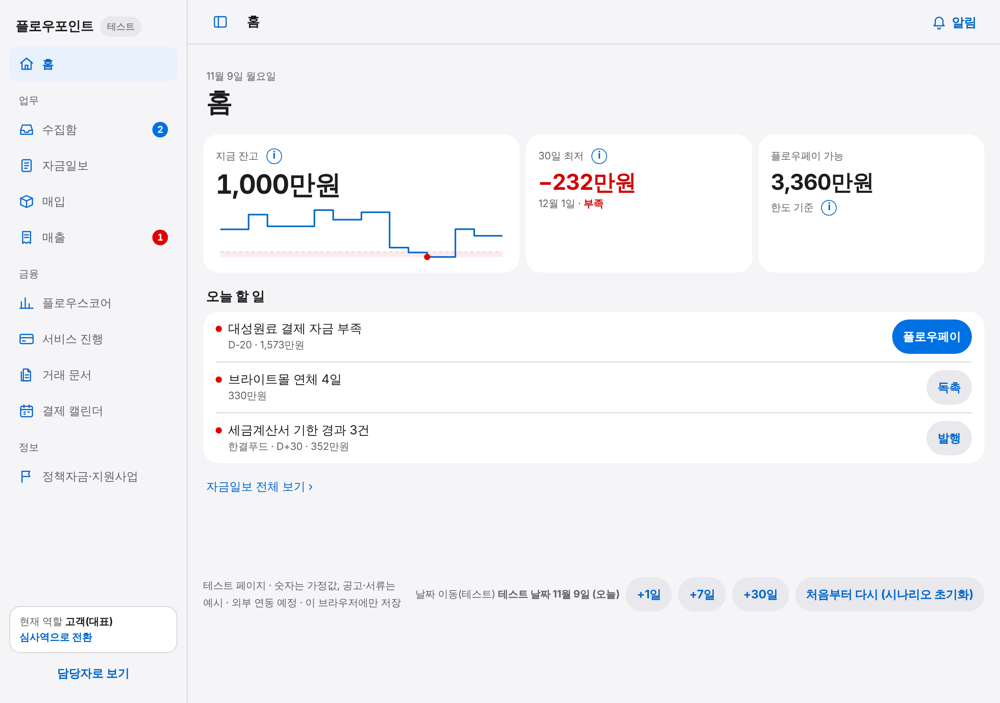

### 2. 수집함: 담당자 확인 → 대표 승인
1. **담당자로 보기**를 누릅니다(승인 창이 뜨면 **나중에**). **업무 → 수집함**에 이메일로 들어온 엑셀 파일에서 읽은 2건이 있습니다.
   - 매입 세진화학 염료 200개 × 25,000원
   - 매출 오렌지유통 완제품 B 280개 × 22,000원: **확인 필요 · 날짜 없음**
2. 오렌지유통 줄 **수정** → 날짜(입금 예정일)를 **12월 19일**로 넣고 **저장**.
3. **모두 확인 완료 (2건)**. 담당자는 여기까지만 할 수 있습니다(매입 목록의 **플로우페이로 결제**도 **대표 승인 요청**으로 바뀜).
4. **대표로 보기** → **수집함**에 "담당자 확인 완료" 2건 → **일괄 승인 (2건)**. 매입·매출에 등록되고 점수가 620 → 624점이 됩니다.

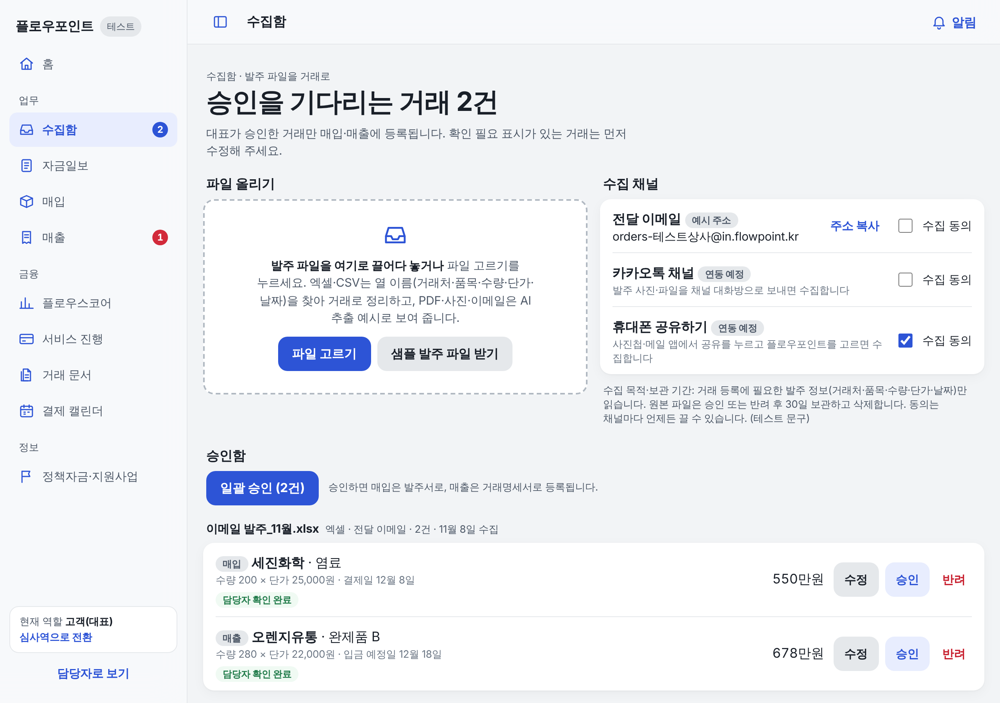

직접 해 보기: **샘플 발주 파일 받기**로 받은 CSV나 엑셀을 **파일 고르기**로 올리면 열 이름(거래처·품목·수량·단가·날짜·구분)을 찾아 후보로 정리합니다. PDF·사진은 "AI 추출 예시" 1건으로 보입니다.

### 3. 매출 목록: 한 줄에 버튼 하나, 나머지는 상세 시트
**업무 → 매출**. 줄마다 업체 · 금액 · 날짜 · 상태와 버튼 하나만 있습니다.

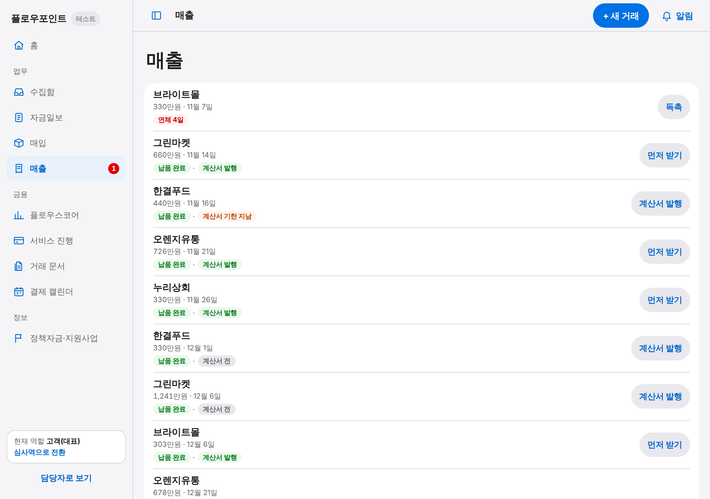

1. "연체 4일" **브라이트몰** 줄을 누르면 상세 시트가 열립니다: 330만원 · 단가·입금 예정일·세금계산서 · 버튼 **독촉**(채움) · **입금 확인** · **명세서 보기**. **입금 확인** → 브라이트몰 534 → 616점, 우리 회사 624 → 649점. 시트는 저절로 닫힙니다.

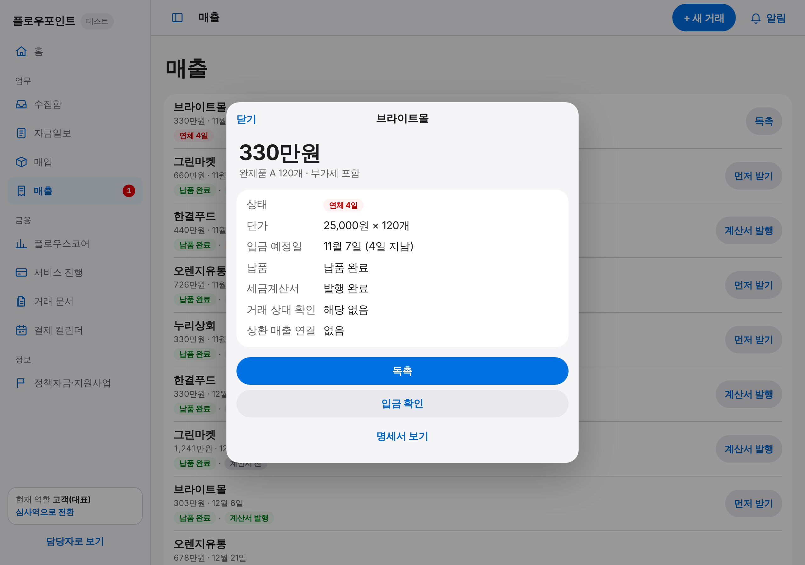

2. 맨 위 "계산서 기한 경과" 한결푸드(352만원) 줄 **세금계산서 발행** → 우리 회사 649 → **689점**.
3. 방금 등록된 오렌지유통(12월 19일, 678만원) 줄도 **세금계산서 발행**(뒤에서 유동화 대상).

**플로우스코어 → 우리 회사** 아래 **점수 변동 기록**에서 사건별 점수 변화를 확인합니다.

새 거래를 넣을 때는 위 오른쪽 **+ 새 거래**(매입은 새 발주서, 매출은 새 거래명세서 시트)를 씁니다.

### 4. 플로우페이 신청 (구매 대행형, 4단계)
**업무 → 매입**에서 대성원료 1,573만원(면 원단 650개) 줄의 **플로우페이로 결제**. 아래 **다음**으로 넘어갑니다(컴퓨터는 Enter = 다음, Esc = 닫기).

1. **① 매입 확인**: 매입처·품목·매입가 확인.
2. **② 상환할 매출 묶기**: 묶은 매출 대금이 들어온 날 그대로 276에 넘겨 갚습니다. 묶은 매출 합계가 **넘길 금액 15,965,090원**(납품액 − 마일리지)보다 적으면 다음으로 갈 수 없습니다.
   - **그린마켓 (1,241만원, 12월 4일)**만 묶으면 "3,557,090원 더 묶어 주세요"로 막힘
   - **한결푸드 440만원(11월 14일)**을 더 묶으면 합계 16,808,000원 → **다음** 가능(남는 842,910원은 고객사에)
   - 다른 신청에 이미 묶인 매출은 고를 수 없습니다.
3. **③ 서류 확인**: 버튼이 **"서류 3건 남음"**으로 막혀 있습니다. 법인등기부등본 · 대표자 신분증 사본 · 부가세 과세표준증명원을 **올리기**.

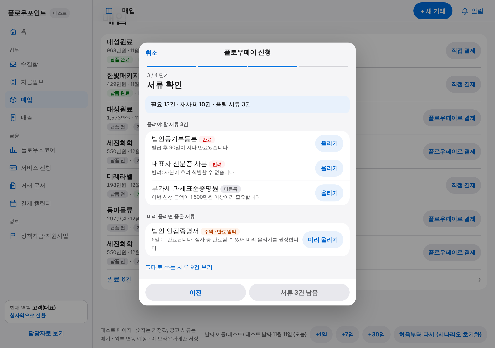

4. **④ 납품액·상환 일정 확인 후 신청**: 결제 기간은 묶은 매출 입금일에 맞춰 **30일 (제안)**.
   - 매입가 공급가액 14,300,000 / 세액 1,430,000 / 합계 **15,730,000원**
   - 납품액 공급가액 14,771,900 (가산율 3.3%) / 세액 1,477,190 / 합계 **16,249,090원**
   - 상환: **묶은 매출 대금으로 (입금일 당일 276에 넘김)**, 마일리지 **284,000원** 차감 → 넘길 금액 **15,965,090원**
   - 상환 일정(ⓘ 아래 표): **한결푸드 11월 14일 4,400,000원 → 그린마켓 12월 4일 11,565,090원**(입금 예정일 순서로 채움)
   - 90일로 바꾸면 넘길 금액이 17,019,000원이 되어 "211,000원 더 묶어 주세요"로 막힙니다. 30일로 두고 **신청하기**. 마지막 단계에 "최종 가격은 영업 담당과 협의 후 확정" 한 줄이 보입니다.

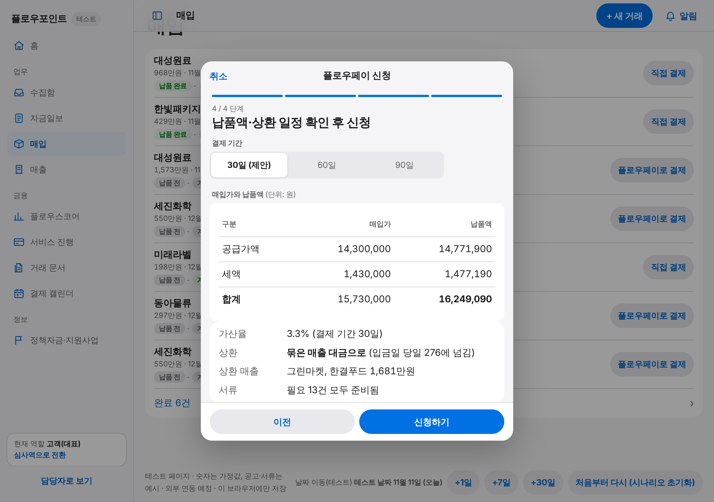

### 5. 거래 상대 확인
묶은 두 매출 모두 세금계산서를 발행하지 않아 먼저 **거래 상대 확인**에서 멈춥니다. **서비스 진행 → 플로우페이 신청 내역**에서 **그린마켓 확인 (테스트)** · **한결푸드 확인 (테스트)** → 심사로 넘어갑니다.

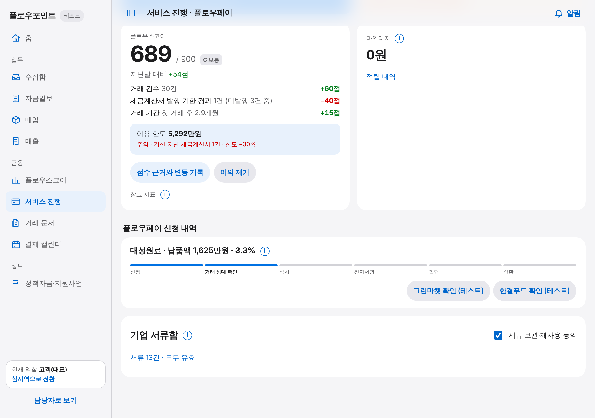

### 6. 전자서명 (심사 승인 뒤)
심사 1 승인 후 **고객(대표)으로 전환** → **서비스 진행 → 전자서명하기**. 276이 매입처에 대금을 내는 구조로 집행되고 **거래 문서**에 문서 7종이 생깁니다: ① 고객 발주서(완료) ② 매입처 발주서(보냄) ③ 매입 세금계산서 ④ 대금 지급 ⑤ 판매 세금계산서 ⑥ 납품 확인 ⑦ **묶은 매출 대금 넘김(건별)**.

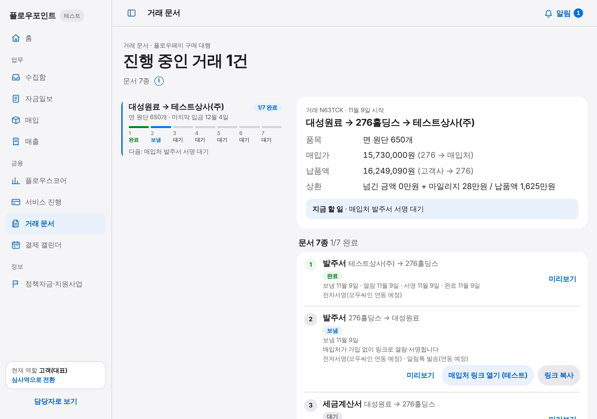

### 7. 납품 확인 (매입처 처리·심사 2 뒤)
**거래 문서**의 ⑥ 납품 확인 줄 **납품 확인** 시트에서
1. 품목·수량·금액 확인에 체크 → **거래명세서에 서명**
2. **입고 사진(필수)** 올리기(긴 변 800px 이하로 줄여 저장)
3. **넘김 일정 확인**: 한결푸드 11월 14일 4,400,000원 · 그린마켓 12월 4일 11,565,090원 → "묶은 매출 대금을 입금일 당일 276에 넘기겠습니다" 체크 → **납품 확인 완료**

납품 확인 전에는 ⑦ 대금 넘김을 완료할 수 없습니다(증빙이 빠지면 다음 단계 진행 불가).

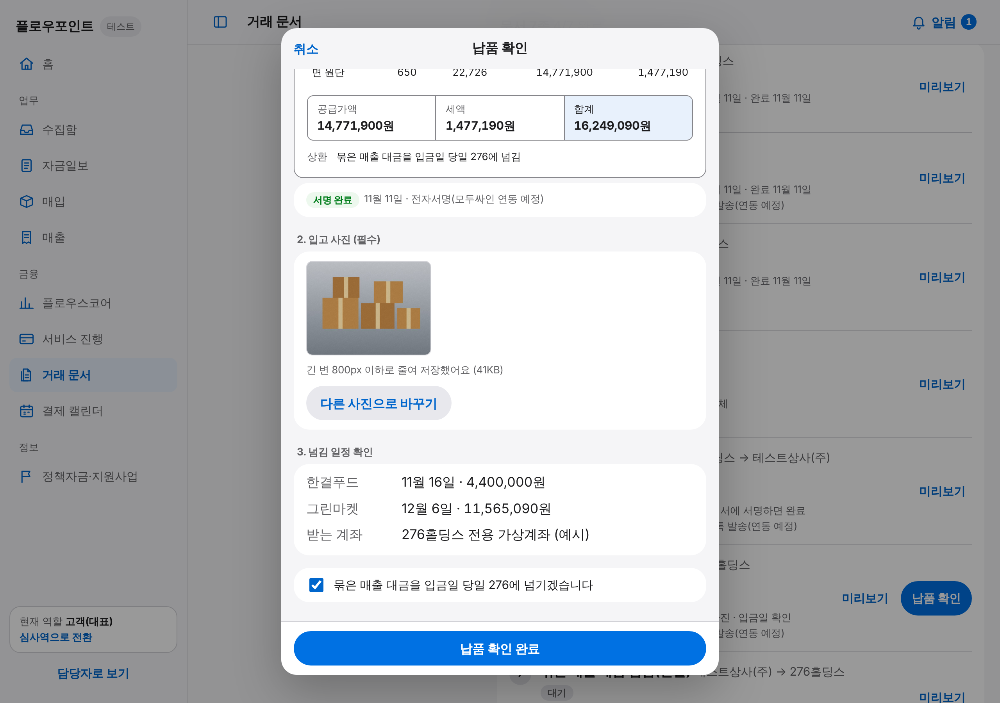

### 8. 묶은 매출 입금 확인 → 276에 넘기기
**매출**에서 묶은 매출 줄은 상태가 **상환 매출 · 넘김 대기**로 보입니다.
1. **한결푸드 440만원 (상환 매출 · 넘김 대기)** 줄을 눌러 상세 시트 → **입금 확인**. 바로 **오늘 276에 넘길 금액 4,400,000원** 시트가 뜹니다.
2. 이번에는 **나중에**를 눌러 봅니다. 줄 버튼이 **넘기기**로 바뀌고, 자금일보에 "276에 넘김 (한결푸드 매출) 오늘 −440만원"이 잡힙니다.
3. 줄의 **넘기기** → **276에 넘기기**. "276에 4,400,000원을 넘겼습니다 · 남은 금액 11,565,090원".

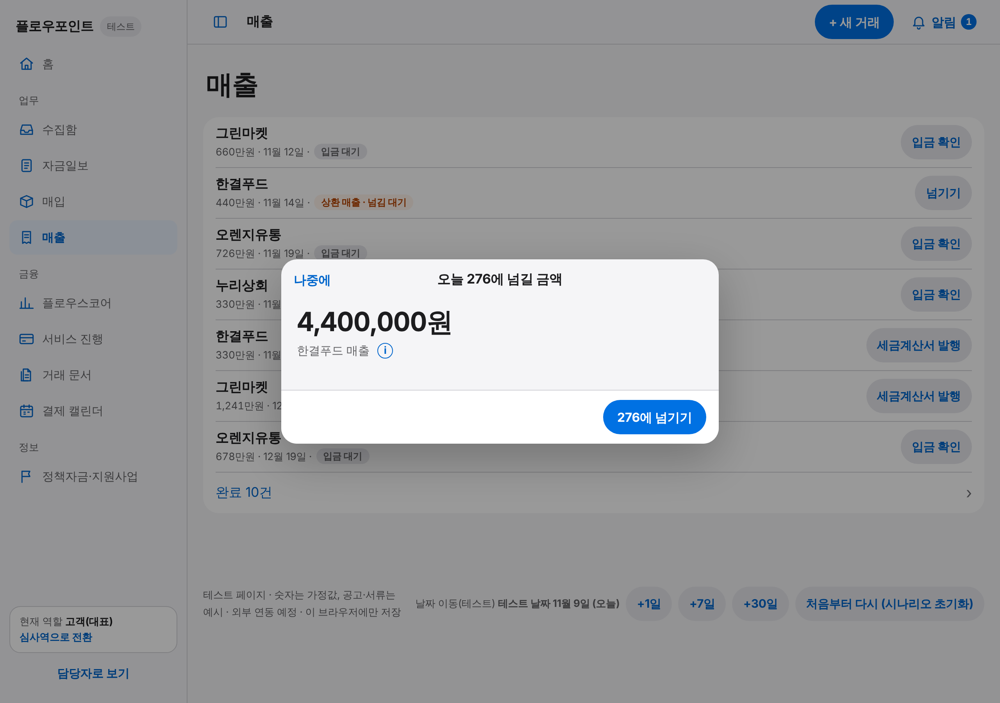

4. **서비스 진행**의 신청 카드: **넘긴 금액 440만원 + 마일리지 28만원 / 납품액 1,625만원**, 진행 막대 **상환 중 28% · 남은 1,157만원**, 매출별로 한결푸드 넘김 완료 · 그린마켓 입금 예정(12월 4일 입금 · 12월 11일까지 넘김).

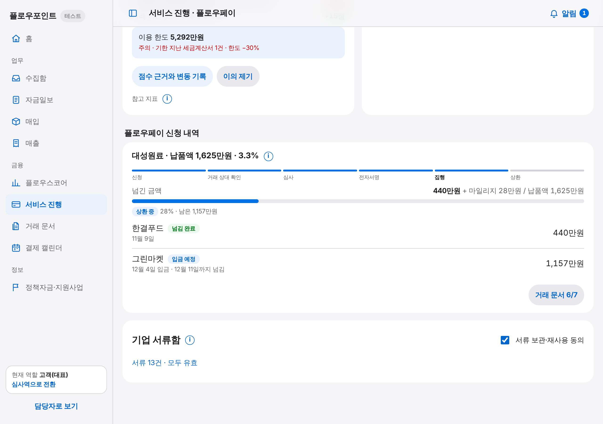

5. **거래 문서 → ⑦ 묶은 매출 대금 넘김(건별) 미리보기**: 한결푸드 11월 9일 넘김 4,400,000 / 그린마켓 12월 4일 입금 예정 · 12월 11일까지 11,565,090 (예정), 넘긴 합계 4,400,000원 · 마일리지 차감 284,000원 · 납품액 16,249,090원, 남은 금액 11,565,090원 · 상태 상환 중.

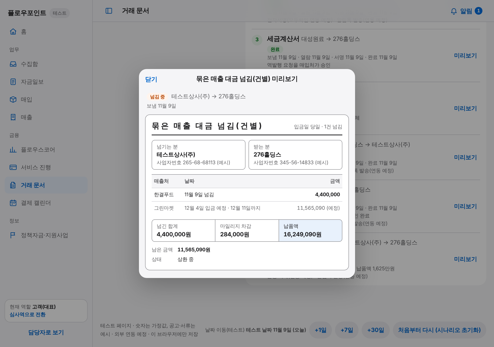

### 9. 날짜 이동으로 상환 알림 확인
1. 맨 아래 **+30일** → 테스트 날짜 12월 9일. "알림 3건 보냄"(그린마켓 D-7 · 당일 · D+1 넘김 안내).
2. **결제 캘린더**: 플로우페이 상환 카드에 매출별 일정이 보입니다. 한결푸드는 이미 넘겨 모두 건너뜀, 그린마켓(12월 4일)은 D-7 · 당일 09:00 · D+1 넘김 안내 **보냄**, **D+7 연체 기준(12월 11일) 예정**. **캘린더 초대 (.ics)**로 내 캘린더에 넣을 수 있습니다.
3. 위 오른쪽 **알림**(안 읽은 4건) → **모두 읽음으로 표시**.

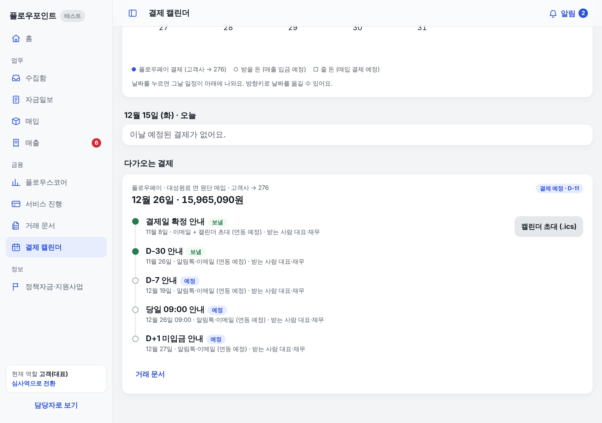

4. 날짜를 옮기는 동안 입금 예정일이 지난 매출 4건이 연체로 바뀌어 점수가 529점(한도 812만원)으로 내려갑니다. **매출**에서 "연체" 줄마다 상세 시트 **입금 확인**(그동안 입금됐다고 가정)을 누르면 **629점**, 한도 **3,612만원**이 됩니다.

### 10. 마지막 넘김 → 완납과 감사 메일
1. **매출**의 **그린마켓 1,241만원 (상환 매출 · 넘김 대기 · D+5)** 줄 상세 → **입금 확인** → **오늘 276에 넘길 금액 11,565,090원** → **276에 넘기기**.
2. "상환 완료, 감사 메일을 알림함에 준비했습니다". 입금 12,408,000원 중 넘기고 남은 842,910원은 고객사 잔고에 남습니다. 두 줄 모두 **넘김 완료**가 되어 **완료 N건** 아래로 접힙니다.
3. 점수: 그린마켓 입금 확인 629 → 654점, **플로우페이 상환 완료 654 → 679점**. 서비스 진행 카드는 **상환 완료 100%**, 거래 문서 7종 모두 완료.
4. **거래 문서 → 감사 메일 미리보기**: 플로우스코어 **654점 → 679점 (+25점)**, 이용 한도 **4,312만원 → 5,012만원 (+700만원)**과 다음 거래 제안(이메일 연동 예정).

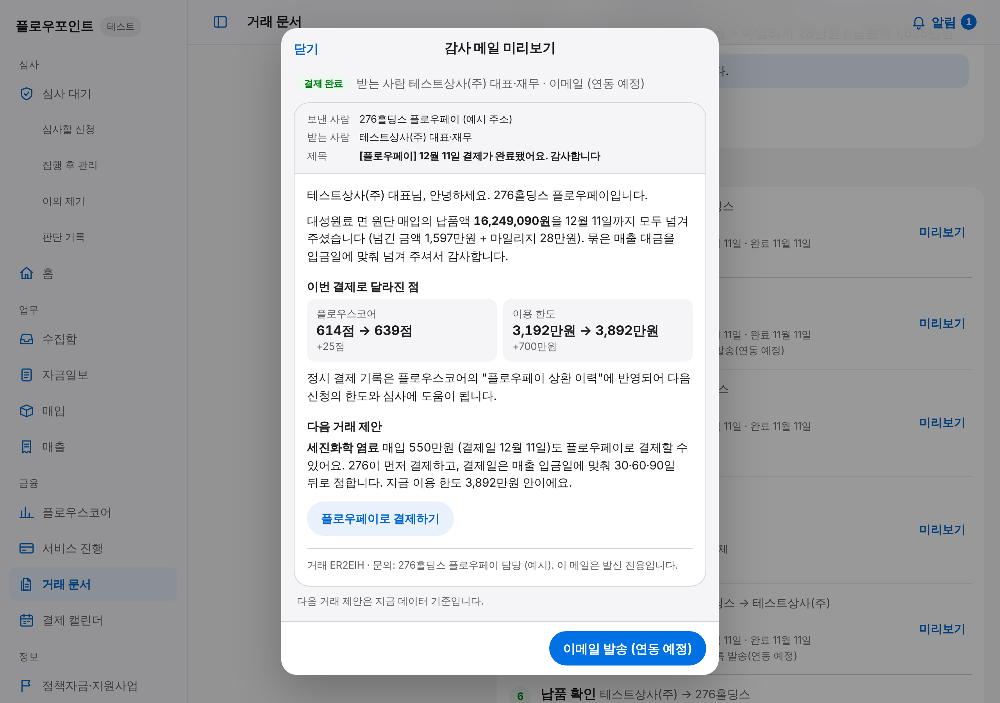

### 11. 매출채권 유동화 (납품 후 금융)
1. **매출**에서 오렌지유통(12월 19일, 678만원) 줄 상세 → **유동화 신청**: ① 확인 두 개 체크 → ② 채권 정보 → ③ 날짜가 지나 만료된 법인 인감증명서 **올리기** → ④ **신청하기**.
2. 심사역이 승인(심사 4)하면 **서비스 진행 → 매출채권유동화 → 전자서명하기**. 바로 돈이 나가지 않고 **채무자 통지**에서 멈춥니다.
3. **채무자 승낙 확인 (테스트)**를 눌러야 자금이 지급됩니다(+6,656,210원).

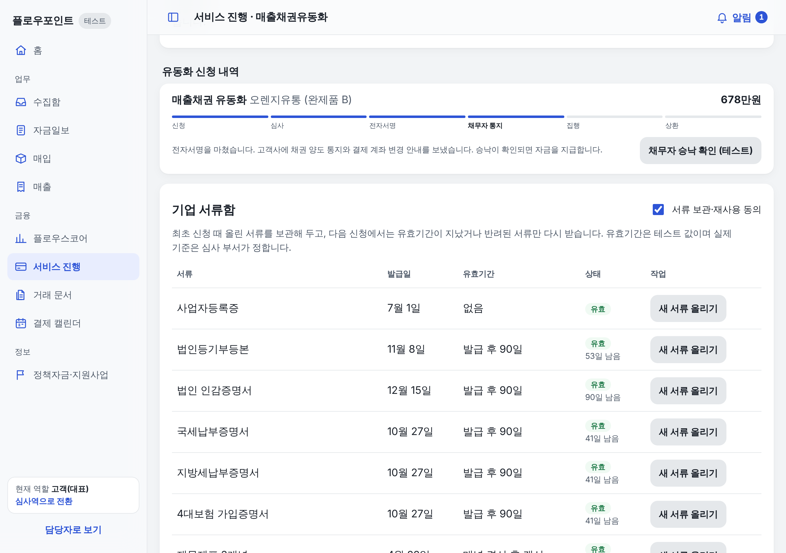

### 12. 이의 제기
**서비스 진행 → 이의 제기**에 내용을 남기면 심사역 화면 **이의 제기**에 올라갑니다.

---

## 연체 경우 (넘기지 않으면)

**처음부터 다시** → 영업 1~6(전자서명까지)을 같은 순서로 한 뒤:

1. **매출 → 한결푸드 440만원 (상환 매출)** 상세 → **입금 확인** → **나중에**(넘기지 않음). 당일에는 아무 알림도 없습니다.
2. **+1일** → "알림 1건 보냄 · 심사 피드로 넘김 지연 전달".
   - 알림함: **[넘김 지연] 한결푸드 매출 대금 11월 9일 입금 확인 · 276에 4,400,000원을 아직 넘기지 않았어요**
   - 홈 오늘 할 일 맨 위: **한결푸드 매출 넘김 대기 · 1일째 · 440만원 [넘기기]**
   - 심사역 이슈 피드: **주의 · 넘김 지연** (276에 4,400,000원 아직 안 넘김)
3. 날짜를 계속 옮깁니다(+1일 · +7일 · +1일 × 3 = 11월 21일, 한결푸드 입금 예정일 11월 14일 + 유예 7일). 여기까지는 **연체 아님**(넘김 대기).
4. **+1일 (D+8, 11월 22일)** → "플로우페이 연체 처리". 우리 회사 **601 → 481점**(플로우페이 연체 −120점). 매출 줄은 **상환 매출 · 연체 [넘기기]**, 서비스 진행 카드는 **연체**.
5. 연체 뒤에도 넘길 수 있습니다. **+30일 · +30일** 뒤(1월 21일) 남은 거래 문서를 화면에서 마칩니다: 매입처 링크 서명·역발행 승인 → 심사역 **대금 지급 실행 · 고객사에 세금계산서 발행** → 대표 **납품 확인**.
6. **매출**에서 한결푸드 **넘기기 → 276에 넘기기**(4,400,000원), 그린마켓 1,241만원 상세 **입금 확인 → 276에 넘기기**(11,565,090원) → **"연체 후 완납, 감사 메일을 알림함에 준비했습니다"**.
   - 연체 기록은 남고 완납은 상환 이력에 더해집니다(점수 360 → 385점, "플로우페이 연체 후 완납").
   - 매입은 상환 완료로 바뀌어 한도 사용분(1,573만원)이 풀립니다.
   - 서비스 진행: **연체 후 완납 100%**, 문서 7 미리보기: 두 건 모두 1월 21일 넘김 · 남은 금액 0원 · 완납 확인(연체 후 완납).

---

## 매입처 순서 (링크 화면)

매입처는 가입하지 않고 알림톡 링크로 처리합니다. 테스트에서는 고객 화면 **거래 문서** ② 매입처 발주서 줄의 **매입처 링크 열기 (테스트)**로 엽니다. 사이드바 없는 외부용 화면(4단계)입니다.

1. **열람**: "276홀딩스가 발주서를 보냈습니다" → **확인했어요, 서명하러 가기**
2. **전자서명**: 발주서 내용 확인에 체크 → **서명하기**(체크 전에는 막힘)
3. **세금계산서**: "직접 발행했어요(정발행)" 또는 **"276홀딩스 역발행 요청 승인"** 선택 → **역발행 승인**
4. **완료**: "처리를 모두 마쳤어요". 아래 **테스트: 플로우포인트로 돌아가기**.

48시간(테스트 날짜 +2일) 안에 서명하지 않으면 알림톡 재알림이 기록되고 거래 문서에 "재알림 발송됨"이 붙습니다.

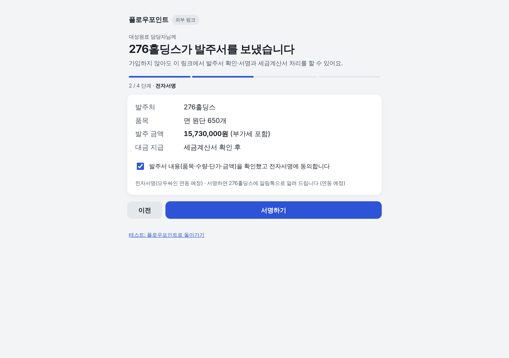

---

## 심사팀 순서 (심사역 화면)

### 심사 1. 포트폴리오 · 이슈 피드 · AI 검토 보고서
**심사역으로 전환**하면 **심사** 화면이 열립니다.
- **고객사 포트폴리오**: 실제 고객사 테스트상사(주)와 예시 3곳. 이름을 누르면 그 회사 이슈만 봅니다.
- **심사할 신청**: 대성원료 구매 대행 1,573만원(납품액 1,625만원, 가산율 3.3%), 표시 "주의 · 미발행 매출 연결 2건", "확인됨 · 거래 상대 확인 완료", "주의 · 세금계산서 발행 기한 경과 1건".
- **AI 검토 보고서(예시 · 결정은 심사역)**: 한 줄 요약(689점 C 보통, 확인할 리스크 2건, **상환 매출 2건이 넘길 금액의 105%를 덮고 입금일 당일 276에 넘김**) · 최근 30일/90일 거래 흐름 · 리스크와 근거(각 줄에 근거 화면 링크) · 추가로 확인할 것. 규칙 기반 요약이며 AI 연동은 예정입니다.
- **판단 사유**(예: 입금 이력 양호, 세금계산서 미발행)를 골라 **승인**. 사유 없이는 승인되지 않습니다.

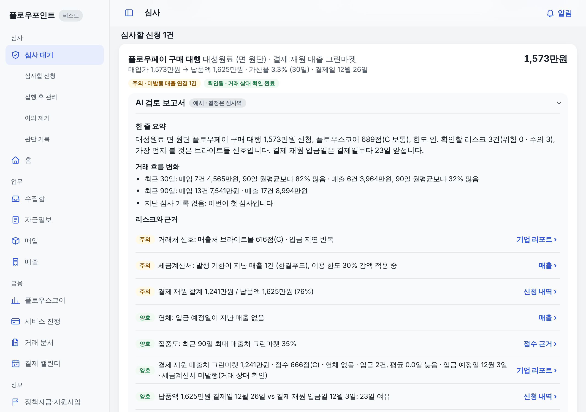

### 심사 2. 대금 지급 · 고객사 세금계산서 발행 (매입처 처리 뒤)
**거래 문서**에서 **대금 지급 실행**(은행 이체 연동 예정) → **고객사에 세금계산서 발행**. 앞 문서가 끝나지 않으면 버튼이 막힙니다.

### 심사 3. 자동 정산 결과 확인
묶음 상환은 **자동 정산**입니다. **집행 후 관리**에는 상환 완료·연체 버튼이 없고 "넘긴 금액 / 납품액"과 결과(상환 중 → 상환 완료 · 연체 · 연체 후 완납)만 보입니다. 납품액을 모두 넘기면 상환 완료, 입금 예정일 7일 뒤까지 못 넘긴 건이 있으면 연체로 자동 처리됩니다.

### 심사 4. 유동화 승인과 연체 기록
1. 오렌지유통 유동화 신청에 사유(예: 관련 거래처 우량)를 골라 **승인**.
2. 고객이 서명·채무자 승낙까지 마치면 **집행 후 관리 → 연체 처리**(유동화는 수동): 우리 회사 640 → **520점**, 오렌지유통 635 → 515점.

### 심사 5. 이슈 피드 조치
**이슈 피드**(전체 3 · 미확인 3 · 위험 1)에서
1. 첫 줄 "위험 · 거래처 점수 급락" **확인** → "확인함" 표시.
2. 둘째 줄 **조치 기록** → 유형(고객 연락·서류 요청·한도 조정 검토·모니터링) 선택과 메모(예: "대표와 통화, 금요일까지 입금 약속") → 저장. 아무것도 안 고르면 저장되지 않습니다.

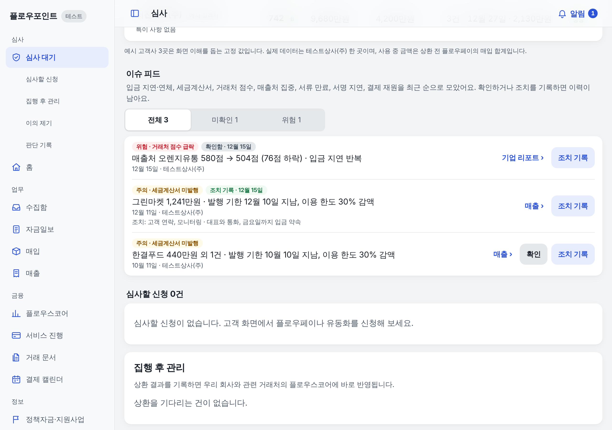

### 심사 6. 판단 기록과 이의 제기
**판단 기록 (정답 데이터)**에 판단 사유와 이후 결과(상환 완료 · 연체)가 쌓이고, **이의 제기**에 고객 의견이 보입니다.

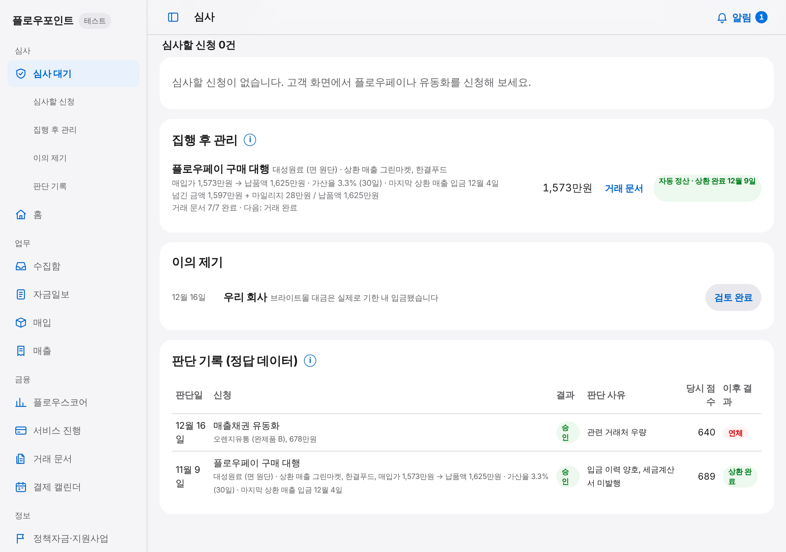

마지막으로 **처음부터 다시**를 누르면 테스트 날짜·역할·기록이 처음으로 돌아갑니다.

---

## 회의용 확인 질문

### 영업팀
1. 홈의 **숫자 3개 + 오늘 할 일 3개**만으로 대표가 "돈이 괜찮은가, 오늘 뭘 해야 하나, 플로우페이 얼마 쓸 수 있나"를 바로 알 수 있나요? 빠진 숫자가 있나요?
2. **수집 채널**: 전달 이메일·카카오톡 채널·휴대폰 공유하기 중 무엇을 먼저 연동할까요? 엑셀·CSV 외에 꼭 받아야 할 형식(PDF 발주서, 사진)이 있나요?
3. 담당자 확인 → 대표 승인 2단계가 고객 회사 실제 업무와 맞나요?
4. **가산율 표시**: 매입가·납품액을 세금계산서 형식으로 보여 주고 가산율(3.3%·6.6%·10%)을 그대로 노출해도 되나요?
5. **묶음 상환**: 고객사가 매출 대금을 받은 날 직접 276에 넘기는 방식(매출처 계좌 변경 통지 없음)을 고객이 받아들일까요? 유예 7일이 적절한가요?
6. **리마인드 일정**: 상환 매출 입금 예정일 기준 D-30·D-7·당일 09:00·D+1, 그리고 입금 확인 다음 날 넘김 지연 알림의 채널(알림톡·이메일)과 받는 사람(대표·재무)이 적절한가요?
7. 매입처가 가입 없이 링크로 서명·세금계산서 처리를 **실제로 해 줄까요?** 48시간 재알림이면 충분한가요?

### 심사팀
1. **증빙 차단 규칙**: 매입처 서명·세금계산서 → 대금 지급 → 판매 세금계산서 → 납품 확인(사진·서명) → 대금 넘김 완료 순서로 막는 것이 맞나요?
2. **묶은 매출 기준**: 묶은 매출 합계(부가세 포함)가 넘길 금액 이상이면 신청 가능(예: 105%)으로 충분한가요? 여유 비율을 둘까요?
3. **이슈 알림 기준**: 입금 지연·연체, 세금계산서 미발행, 거래처 점수 급락, 서류 만료, 서명 지연, 넘김 지연(입금 확인 다음 날) 중 기준값을 바꿀 것이 있나요?
4. AI 검토 보고서의 항목(요약·거래 흐름 변화·리스크와 근거·추가 확인)이 실제 심사 메모로 쓸 만한가요?
5. 산식 가감점(플로우페이 연체 −120점, 연체 후 완납은 상환 이력으로 더함, 세금계산서 기한 경과 시 한도 30% 감액)이 적절한가요?
6. 유동화 채무자 통지는 **승낙까지 받아야** 하나요?

### 함께 정할 것
1. 이번 검증으로 **확정할 데이터 항목**(수집 후보, 거래 문서 7종, 넘김 기록, 알림 기록, 이슈 조치 기록)
2. 다음 단계 우선순위: 서버 저장과 로그인 / 외부 연동(모두싸인·알림톡·홈택스·은행) / 실제 AI 추출 / 파일럿 고객
3. 최종 가격(가산율) 결정 절차와 화면 문구
